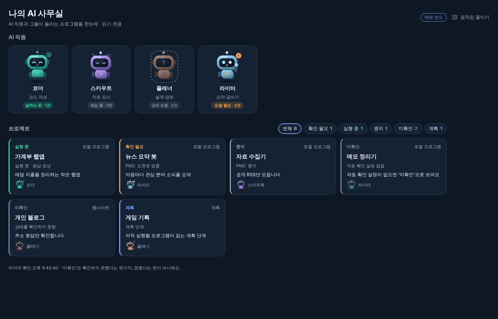

# AI Office · AI 직원 사무실

AI 에이전트 여러 명과 그들이 돌리는 프로그램을 **한 화면에서 조용히** 지켜보는 대시보드입니다.
비개발자가 AI 다섯 명과 일하며 만든 관제판을, 누구나 쓸 수 있게 다시 만든 템플릿이에요.



- **AI 직원마다 로봇 한 대.** 맡은 프로젝트 상태에 따라 로봇 자세가 바뀌어요. 일하는 중, 쉬는 중, 도움 필요, 구상 중, 상태 모름.
- **'미확인'은 '중지'가 아닙니다.** 확인하지 못한 것을 멈춘 것으로 표시하지 않아요. 이 템플릿의 제일 중요한 원칙이에요.
- **읽기 전용.** 시작·종료 버튼이 없어요. 보기만 하니까 실수로 뭘 끌 일이 없어요.
- **내 PC에서만.** `127.0.0.1`에만 열리고, 다른 주소로 들어온 요청은 거절해요.
- **설치할 것 없음.** Node.js 18 이상만 있으면 돼요. 외부 라이브러리를 쓰지 않아요.
- 움직임 줄이기 스위치, 다크/라이트 모드, 휴대폰 화면 지원.

## 시작하기
1. [Node.js](https://nodejs.org) 18 이상 설치
2. Windows: `start.bat` 더블클릭 / macOS·Linux: `./start.sh`
3. 브라우저에서 `http://127.0.0.1:4310/`

처음에는 **데모 모드**라서 가짜 상태가 보여요. 내 환경에 맞추려면 `office.json`을 고치고 `"demo": false`로 바꾸세요.

## office.json
```json
{
  "title": "나의 AI 사무실",
  "port": 4310,
  "demo": false,
  "agents": [
    { "id": "coder", "name": "코더", "role": "코드 작성", "color": "#2dd4bf", "shape": "ears" }
  ],
  "projects": [
    { "id": "budget", "name": "가계부 웹앱", "kind": "service", "owner": "coder",
      "pm2": "budget-app", "health_url": "http://127.0.0.1:5173/",
      "note": "메모", "tasks": ["할 일 1"] }
  ]
}
```

| 항목 | 설명 |
|---|---|
| `agents[].shape` | 로봇 모양: `antenna`, `ears`, `horns`, `round` |
| `agents[].color` | 로봇 색 (예: `#2dd4bf`) |
| `projects[].kind` | `service`(내 PC 프로그램), `website`, `planned`(계획) |
| `projects[].owner` | 담당 AI의 `id` |
| `projects[].pm2` | PM2 앱 이름. 있으면 `pm2 jlist`로 상태를 읽어요 |
| `projects[].health_url` | 응답 확인 주소. 3초 안에 응답하면 정상 |
| `projects[].url` | 상세 창의 "열기" 링크 |

## 상태 규칙
| PM2 | 응답 확인 | 표시 |
|---|---|---|
| online | 정상 또는 설정 없음 | 실행 중 |
| online | 응답 없음 | 확인 필요 |
| errored / launching | - | 확인 필요 |
| stopped | 응답 없음 또는 설정 없음 | 중지 |
| stopped | 정상 | 확인 필요 (다른 곳에서 실행 중일 수 있음) |
| 설정 없음 | 정상 / 응답 없음 | 실행 중 / 확인 필요 |
| 확인 못 함 | 확인 못 함 | **미확인** |

AI 직원 로봇은 맡은 프로젝트 중 하나라도 확인이 필요하면 손을 흔들고, 하나라도 실행 중이면 일하는 자세가 돼요.

## 테스트
```
npm test
```

## 만든 사람
[디아랩](#) — 개발자가 아니어도 AI를 직접 써 보고 나누는 곳. 이 템플릿을 만든 이야기는 디아랩 연재에서 볼 수 있어요.

---

### English (short)
A calm, **read-only** office board for your AI agents and the programs they run. One robot per agent; its pose follows the projects it owns. **"Unknown" is never shown as "stopped."** Binds to `127.0.0.1` only, rejects other Host headers, no control endpoints, zero dependencies (Node 18+). Edit `office.json`, set `"demo": false`, run `node server.js`. MIT licensed.
